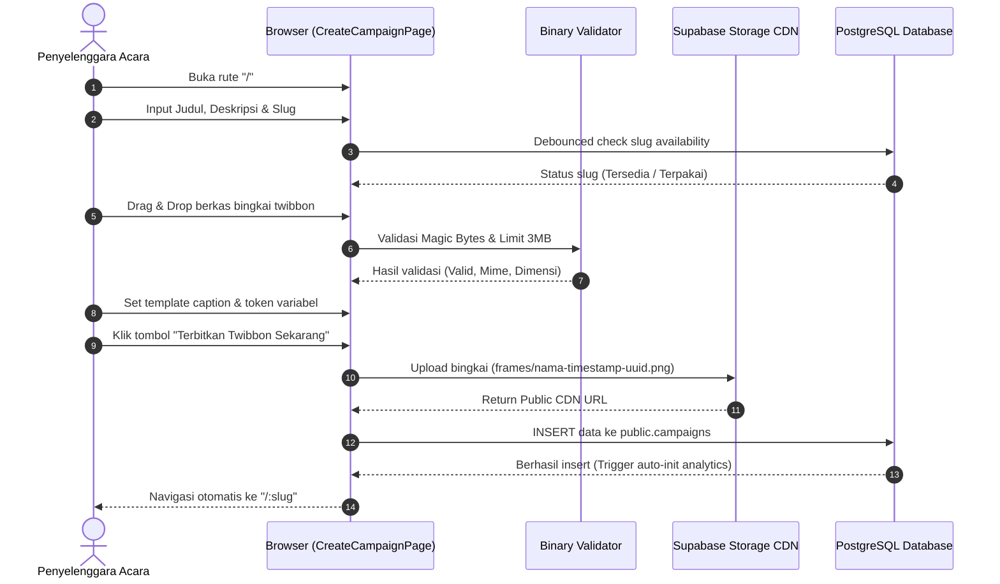
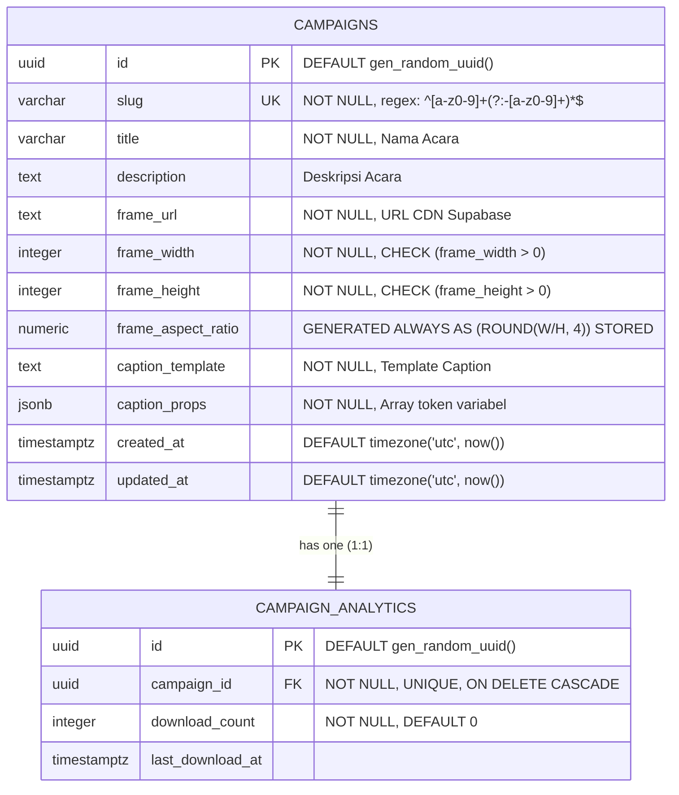

# Product Requirements Document (PRD)
## Project: Freebbonize

**Status:** Living Document / Active  
**Versi:** 2.0.0 (Major Release: Arsitektur Full-Stack & Dynamic Slug Routing)  
**Tanggal Terakhir Diperbarui:** 17 November 2026  
**Tim Pengembang:**
- **Lead Developer**: [Farel Alghazali](https://github.com/GithubFarelAlghazali)
- **Contributor**: [christianxavierVibecode](https://github.com/christianxavierVibecode)

---

## 1. Executive Summary & Project Overview

**Freebbonize** adalah aplikasi web generator Twibbon dan platform kampanye visual sumber terbuka (*open-source*) yang ringan, cepat, mandiri (*self-hosted*), dan mengutamakan privasi pengguna (*privacy-first*). 

Dibangun dengan **React 19**, **TypeScript**, **Vite 8**, **Tailwind CSS v4**, **PostgreSQL 17**, dan **Supabase Storage**, Freebbonize hadir sebagai alternatif independen dari platform pihak ketiga komersial (seperti Twibbonize) yang kerap membebani pengguna dengan iklan invasif, kewajiban registrasi akun, pemaksaan *crop* 1:1, serta pengunggahan foto pengguna ke server eksternal.

Freebbonize mengadopsi model **zero-friction**:
1. **Penyelenggara Acara (*Organizer*)**: Dapat langsung meluncurkan kampanye baru pada rute `/` tanpa perlu registrasi/login, menentukan tautan URL *slug* unik yang divalidasi secara *real-time*, mengunggah bingkai twibbon berasio bebas (drag & drop), dan menyusun template kalimat caption media sosial.
2. **Peserta Acara (*Participant*)**: Mengakses halaman kampanye dinamis pada rute `/:slug`, mengunggah foto diri yang **100% diproses di browser lokal** (*zero server egress*), memanipulasi posisi kanvas 2D secara interaktif, mengisi variabel caption, dan mengunduh berkas twibbon resolusi tinggi dalam format PNG.

---

## 2. Problem Statement, Objectives & Scope

### 2.1 Analisis Permasalahan (Problem Statement)
- **Isu Privasi Data Pribadi**: Platform twibbon komersial umumnya memproses dan mengunggah foto peserta ke server backend mereka, menimbulkan kekhawatiran penyalahgunaan data wajah/biometrik.
- **Friksi Akses & Iklan Berlebih**: Kewajiban membuat akun, verifikasi email, pop-up iklan komersial, dan jeda unduhan mengganggu kenyamanan pengguna.
- **Keterbatasan Format (Forced 1:1 Square Crop)**: Banyak platform memaksa bingkai menjadi bujursangkar, memotong desain poster potret (4:5, 9:16) atau lanskap (16:9).
- **Kerentanan Berkas Palsu**: Tidak adanya validasi tipe berkas biner di server memungkinkan berkas non-gambar atau skrip berbahaya terselubung ekstensi `.png`.

### 2.2 Tujuan Produk (Product Goals)
- **100% Client-Side Privacy**: Seluruh pemrosesan grafis foto peserta dilakukan di memori peramban (*in-memory* Blob / HTML5 Canvas). Foto peserta tidak pernah dikirimkan ke server backend mana pun.
- **Zero-Friction No-Login Workflow**: Penyelenggara dan peserta dapat langsung berinteraksi dengan aplikasi tanpa login atau verifikasi identitas.
- **Dukungan Rasio Aspek Fleksibel**: Kanvas secara dinamis mengadaptasi dimensi fisik alami bingkai twibbon tanpa memaksa pemotongan kotak.
- **Validasi Keamanan Berkas Berlapis**: Pengecekan *binary magic bytes* (PNG, JPEG, WEBP) dan pembatasan ketat ukuran berkas maksimal 3MB.
- **Desain Kelas Dunia**: Mengadopsi sistem estetika **Raycast Dark Midnight Command Center** bernuansa *cockpit* profesional yang cepat dan bersih.

### 2.3 Batasan Ruang Lingkup (Non-Goals / Out of Scope)
- Sistem autentikasi pengguna berbasis password/OTP/OAuth (sengaja ditiadakan demi menjaga kemudahan akses).
- *In-app payment gateway* untuk kampanye berbayar.
- Editor grafis tingkat lanjut berbasis vektor (seperti Photoshop/Canva) di dalam aplikasi.

---

## 3. Target Audiens & Persona

| Peran | Profil & Karakteristik | Kebutuhan Utama |
|---|---|---|
| **Penyelenggara Acara (*Organizer*)** | Panitia kegiatan kampus, komunitas teknologi, pengurus organisasi, tim media promosi. | - Peluncuran kampanye cepat dalam < 1 menit.<br>- Pilihan slug URL yang rapi dan mudah dibagikan.<br>- Upload bingkai dengan format rasio bebas.<br>- Template teks promosi media sosial dengan variabel isian. |
| **Peserta Kampanye (*Participant*)** | Mahasiswa, peserta seminar, anggota komunitas, audiens publik media sosial. | - Buka link langsung tanpa login/iklan.<br>- Upload foto diri yang cepat dan aman.<br>- Kanvas interaktif yang mulus (geser, rotasi, zoom).<br>- Tombol salin caption dan unduh PNG HD 1-klik. |

---

## 4. User Journey & State Flow

Aplikasi memiliki dua alur utama berdasarkan rute URL:

```
[ ALUR PENYELENGGARA: Route '/' ]
Buka Halaman Utama ──► Isi Judul & Cek Ketersediaan Slug ──► Drag & Drop Frame ──► Set Caption Template ──► Simpan & Redirect

[ ALUR PESERTA: Route '/:slug' ]
Step 1: Landing (Pilih Foto) ──► Step 2: Adjust (Manipulasi Kanvas 2D) ──► Step 3: Ready (Isi Token Caption & Download PNG)
```

---

## 5. Kebutuhan Fungsional (Functional Requirements)

### 5.1 Modul Pembuatan Kampanye (`Route: /`)
- **FR-1.1 Input Judul & Deskripsi**: Penyelenggara wajib mengisi judul kegiatan (maksimal 255 karakter) dan deskripsi opsional.
- **FR-1.2 Normalisasi & Validasi Slug**:
  - Format slug dibatasi karakter: huruf kecil `a-z`, angka `0-9`, dan tanda hubung `-` (`/^[a-z0-9]+(?:-[a-z0-9]+)*$/`).
  - Pencegahan penggunaan kata kunci sistem terlarang (*reserved slugs*): `admin`, `api`, `create`, `new`, `assets`, `public`, `static`, `login`, `register`.
  - Pengecekan ketersediaan slug ke database PostgreSQL secara *real-time* dengan mekanisme *debouncing* (tunda 400ms).
- **FR-1.3 Upload Bingkai Twibbon**:
  - Mendukung pemilihan berkas konvensional dan interaksi **Drag & Drop** dengan indikator visual dinamis saat file di-hover.
  - Membaca dan menampilkan metadata dimensi fisik gambar (`width`, `height`, dan `aspectRatio`).
- **FR-1.4 Pengaturan Template Caption Dinamis**:
  - Penyelenggara dapat menyusun teks caption dengan sintaks token kurung siku (contoh: `[nama]`, `[instansi]`).
  - Sistem mengekstrak daftar variabel secara otomatis dan menyediakan input form untuk menambah/menghapus tag variabel.
- **FR-1.5 Penyimpanan Kampanye**:
  - Berkas bingkai diunggah ke Supabase Storage.
  - Metadata disimpan ke tabel `campaigns`, kemudian browser dialihkan ke halaman `/:slug`.

### 5.2 Modul Validasi Berkas & Keamanan Upload
- **FR-2.1 Batas Ukuran File**: Maksimal 3MB (3.145.728 bytes). Berkas yang melebihi batas ditolak dengan pesan kesalahan yang informatif.
- **FR-2.2 Whitelist Ekstensi**: Hanya menerima `.png`, `.jpg`, `.jpeg`, `.webp`.
- **FR-2.3 Inspeksi Magic Bytes (Header Biner Asli)**:
  - PNG: `89 50 4E 47 0D 0A 1A 0A`
  - JPEG: `FF D8 FF`
  - WEBP: `RIFF` (offset 0..3) dan `WEBP` (offset 8..11)
  - Mencegah serangan *file extension spoofing* (berkas executable/skrip yang dinamai ulang menjadi `.png`).
- **FR-2.4 Multi-layer Enforcement**:
  - Layer 1: Validasi awal di browser via JavaScript FileReader / ArrayBuffer (`src/lib/file-validator.ts`).
  - Layer 2: Validasi server dev melalui Vite Middleware endpoint `/api/validate-frame` (`server/validator.ts`).
  - Layer 3: Supabase Edge Function (`supabase/functions/upload-frame/index.ts`).

### 5.3 Modul Halaman Partisipan (`Route: /:slug`)
- **FR-3.1 Query Data Kampanye**: Mengambil data kampanye dari tabel `public.campaigns` berdasarkan slug.
- **FR-3.2 Penanganan 404**: Jika slug tidak ditemukan di database, sistem menampilkan halaman `NotFoundPage` dengan tautan kembali ke `/`.
- **FR-3.3 State Machine Partisipan**:
  - `landing`: Menampilkan detail judul, deskripsi, preview bingkai twibbon, dan tombol unggah foto.
  - `adjust`: Kanvas interaktif aktif untuk reposisi, transformasi skala, dan rotasi foto.
  - `ready`: Pratinjau hasil akhir, form modal pengisian token caption, tombol salin caption, dan tombol unduh.
- **FR-3.4 Berbagi & Navigasi**: Tombol salin tautan kampanye ke clipboard dan tombol *“Buat Twibbon Baru”*.

### 5.4 Modul Engine Kanvas 2D (`TwibbonCanvas`)
- **FR-4.1 Dimensi Adaptif Berasio Bebas**: Lebar dan tinggi kanvas disesuaikan dengan dimensi alami (*natural resolution*) bingkai twibbon (bukan dipaksa 1:1).
- **FR-4.2 Manipulasi Pointer Events**: Mendukung mouse dan sentuhan layar (*touch gestures*) menggunakan `onPointerDown`, `onPointerMove`, `onPointerUp`, dan `setPointerCapture`.
- **FR-4.3 Transformasi Citra**:
  - Geser / Reposisi: Perpindahan koordinat $X$ dan $Y$ dinormalisasi dengan rasio dimensi fisik terhadap ukuran tampilan layar.
  - Skala (Zoom): Slider rentang $10\%$ hingga $250\%$ (default $100\%$).
  - Rotasi: Slider rentang $-180^\circ$ hingga $+180^\circ$ (default $0^\circ$).
- **FR-4.4 Layering Compositing (Z-Index)**:
  1. *Clear canvas context 2D*.
  2. Gambar foto peserta dengan transformasi ($translate, rotate, scale$ dari titik origin tengah).
  3. Gambar bingkai twibbon transparan di lapisan teratas (*overlay*).
- **FR-4.5 Ekspor Gambar**: Mengekspor komposisi kanvas ke DataURL format PNG kualitas penuh (`image/png`) dan memicu unduhan berkas otomatis.

### 5.5 Modul Caption Dinamis & Clipboard
- **FR-5.1 Evaluasi Token**: Menggantikan token seperti `[nama]` secara reaktif sesuai input peserta. Jika belum diisi, tetap mempertahankan teks default token.
- **FR-5.2 Clipboard API**: Menyalin teks hasil akhir ke clipboard sistem menggunakan `navigator.clipboard.writeText` disertai umpan balik visual (*Copied!*).

---

## 6. Arsitektur Teknis & Alur Data

### 6.1 Sequence Diagram: Alur Pembuatan Kampanye (Penyelenggara)



### 6.2 Sequence Diagram: Alur Pasang Twibbon & Unduh (Peserta)

```mermaid
sequenceDiagram
    autonumber
    actor Participant as Peserta Kampanye
    participant UI as Browser (CampaignViewPage)
    participant DB as PostgreSQL Database
    participant Storage as Supabase Storage CDN
    participant Canvas as HTML5 Canvas Engine (Client-Side)

    Participant->>UI: Akses tautan "/:slug"
    UI->>DB: Query campaign data by slug
    DB-->>UI: Metadata kampanye (title, frame_url, caption_template)
    UI->>Storage: Ambil aset bingkai twibbon
    Storage-->>UI: Aset bingkai dimuat
    Participant->>UI: Pilih / Drag foto profil diri
    Note over UI,Canvas: Foto diproses murni di memori lokal (Blob URL)
    UI->>Canvas: Inisialisasi kanvas beresolusi alami bingkai
    Participant->>Canvas: Atur posisi (drag reposisi, skala zoom, putar)
    Canvas-->>Participant: Render preview reaktif 60 FPS
    Participant->>UI: Klik "Lanjut ke Unduh"
    Participant->>UI: Isi form variabel caption (nama, instansi)
    UI-->>Participant: Salin caption ke clipboard
    Participant->>Canvas: Klik "Unduh Twibbon"
    Canvas->>Canvas: Render full-resolution & toDataURL("image/png")
    Canvas-->>Participant: Unduh file PNG ke perangkat lokal
    UI-)DB: Update analytics download_count (+1)
```

### 6.3 Pola Penamaan Berkas di Storage
Format penamaan berkas yang diunggah ke bucket `freebbonize-files` adalah:
```
frames/<<nama-kegiatan>>-<<unix-timestamp>>-<<random-uuid>>.<<ext>>
```
- `nama-kegiatan`: Judul acara yang telah disanitasi (*lowercase*, spasi menjadi hyphen, alfanumerik saja).
- `unix-timestamp`: Unix timestamp waktu unggah dalam detik (`Math.floor(Date.now() / 1000)`).
- `random-uuid`: UUID acak v4 (`crypto.randomUUID()`).
- `ext`: Ekstensi asli berkas gambar (`png`, `jpg`, `webp`).

---

## 7. Rancangan Database & Keamanan

### 7.1 Entity-Relationship Diagram (ERD)



### 7.2 Database Triggers
1. **`trg_campaigns_updated_at`**: Otomatis memperbarui kolom `updated_at` saat data baris kampanye diubah.
2. **`trg_init_campaign_analytics`**: Fungsi dengan hak akses `SECURITY DEFINER` yang otomatis menyisipkan baris inisialisasi pada `campaign_analytics` sesaat setelah kampanye baru dibuat pada tabel `campaigns`.

### 7.3 Row-Level Security (RLS) Policies
- **Tabel `public.campaigns`**:
  - `SELECT`: Terbuka untuk peran `anon` dan `authenticated`.
  - `INSERT`: Terbuka untuk peran `anon` dan `authenticated` dengan batasan validasi format slug.
- **Tabel `public.campaign_analytics`**:
  - `SELECT`, `INSERT`, `UPDATE`: Terbuka untuk peran `anon` dan `authenticated`.
- **Storage Bucket `freebbonize-files`**:
  - Kebijakan baca (*SELECT*) publik terbuka untuk umum.
  - Kebijakan tulis (*INSERT*) terbuka untuk peran anonim.

### 7.4 Fresh Seeder Mechanism
Perintah `pnpm db:seed` menjalankan skrip penghapusan bersih:
```sql
TRUNCATE TABLE public.campaign_analytics, public.campaigns RESTART IDENTITY CASCADE;
```
Menghapus seluruh rekaman lama secara menyeluruh sebelum menyisipkan ulang data seeder bawaan.

---

## 8. Sistem Desain & Antarmuka Pengguna

Freebbonize mengimplementasikan estetika **Raycast Dark Midnight Command Center**:

### 8.1 Palet Warna Utama
| Token Desain | Nilai HEX | Penggunaan |
|---|---|---|
| `--color-void-black` | `#040506` | Latar belakang canvas utama |
| `--color-ink` | `#07080a` | Background kartu utama (*tactile card*) |
| `--color-obsidian` | `#111214` | Input field, textarea, well dropzone |
| `--color-graphite` | `#1b1c1e` | Container sekunder, hover surface |
| `--color-slate` | `#2f3031` | Border garis kartu dan pembatas |
| `--color-azure-pulse` | `#4d8bff` | Warna aksen brand primer, fokus input, indikator aktif |
| `--color-cobalt-edge` | `#143ca3` | Aksen tombol pendukung dan tag |
| `--color-mist` | `#e6e6e6` | Tombol aksi utama (*primary action button*) |
| `--color-pure-white` | `#ffffff` | Teks heading dan elemen kontras tinggi |

### 8.2 Tipografi
- **Teks Utama**: `Inter`, sans-serif (kebersihan tipografi modern).
- **Teks Monospace**: `JetBrains Mono`, monospace (digunakan untuk *slug*, dimensi piksel, rasio aspek, dan tag variabel token).

---

## 9. Kebutuhan Non-Fungsional (Non-Functional Requirements)

| Kategori | Parameter & Ekspektasi |
|---|---|
| **Privasi Mutlak** | *Zero network egress* untuk foto peserta. Foto diproses murni di memori lokal (*HTML5 2D Canvas*). |
| **Performa Kanvas** | Responsivitas gestur drag, rotasi, dan zoom berjalan lancar pada performa 60 FPS tanpa jeda input. |
| **Kecepatan Build** | Waktu kompilasi produksi Vite < 3 detik; ESLint bebas peringatan (*zero-warning standard*). |
| **Responsivitas** | Tampilan adaptif pada layar mobile (stacked) maupun desktop (split side-by-side). |
| **Kompatibilitas** | Berjalan sempurna pada Google Chrome, Microsoft Edge, Mozilla Firefox, Safari macOS, dan Safari iOS. |

---

## 10. Rencana Pengembangan Mendatang (Future Roadmap)

1. **Multi-Frame Selection**: Mengizinkan satu kampanye memuat lebih dari satu pilihan desain bingkai twibbon.
2. **Text Overlay on Canvas**: Fitur bagi peserta untuk menambahkan nama dan instansi langsung di atas kanvas twibbon sebelum diunduh.
3. **Pinch-to-Zoom Multi-touch Gesture**: Kontrol gestur cubit untuk perbesaran foto secara alami di layar smartphone.
4. **Web Share API**: Tombol satu klik untuk membagikan berkas twibbon dan teks caption langsung ke aplikasi Instagram, WhatsApp, atau X (Twitter).
