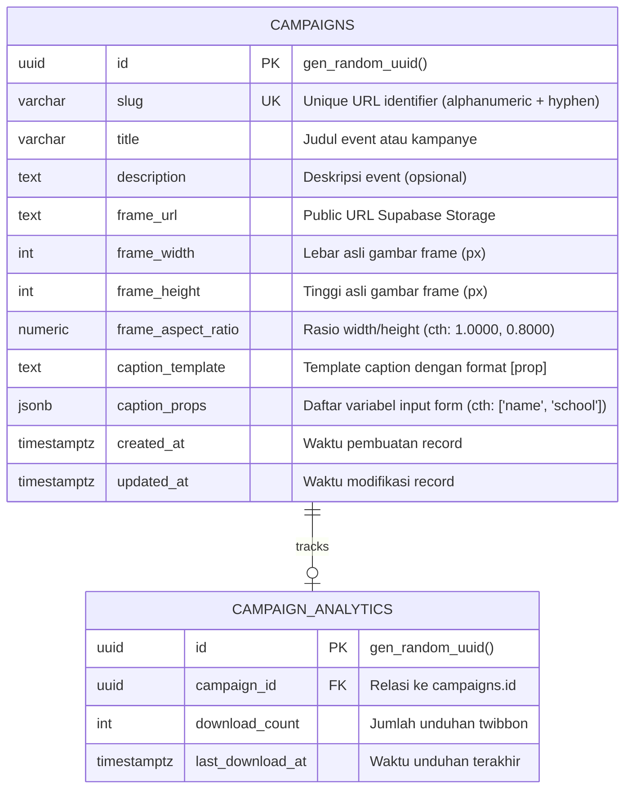

# Implementation Plan: 001 - Database Schema and Seeders

## 1. Overview & Objectives

Dokumen ini mendefinisikan desain skema database PostgreSQL dan data awal (_seeders_) untuk mendukung evolusi Freebbonize dari aplikasi statis menjadi platform multi-kampanye tanpa login. Sistem akan menyimpan metadata kampanye Twibbon (slug unik, URL frame di Supabase Storage, dimensi/aspek rasio frame, serta konfigurasi caption dinamis).

## 2. Design System Reference

Setiap elemen antarmuka, status loading database, pesan kesalahan, dan validasi formulir yang berhubungan dengan data harus merujuk pada standar desain berikut:

- **Design Reference File:** `DevReferences/Skills/DESIGN.md`
- **Tipografi:** Inter untuk teks antarmuka, GeistMono untuk slug, metadata, dan kode teknis.

---

## 3. Entity-Relationship Diagram (ERD)



---

## 4. Skema Database Lengkap (PostgreSQL DDL)

Berikut adalah skrip SQL lengkap untuk inisialisasi tabel, constraint, index, dan Row Level Security (RLS) pada PostgreSQL / Supabase:

```sql
-- 1. Enable extension UUID
CREATE EXTENSION IF NOT EXISTS "uuid-ossp";

-- 2. Create Table: campaigns
CREATE TABLE IF NOT EXISTS public.campaigns (
    id UUID PRIMARY KEY DEFAULT gen_random_uuid(),
    slug VARCHAR(100) NOT NULL,
    title VARCHAR(255) NOT NULL,
    description TEXT,
    frame_url TEXT NOT NULL,
    frame_width INTEGER NOT NULL CHECK (frame_width > 0),
    frame_height INTEGER NOT NULL CHECK (frame_height > 0),
    frame_aspect_ratio NUMERIC(6, 4) GENERATED ALWAYS AS (
        ROUND((frame_width::numeric / frame_height::numeric), 4)
    ) STORED,
    caption_template TEXT NOT NULL DEFAULT 'I am ready to participate in [event]! Join me at [link]',
    caption_props JSONB NOT NULL DEFAULT '["name"]'::jsonb,
    created_at TIMESTAMPTZ NOT NULL DEFAULT timezone('utc'::text, now()),
    updated_at TIMESTAMPTZ NOT NULL DEFAULT timezone('utc'::text, now()),

    -- Constraints
    CONSTRAINT campaigns_slug_unique UNIQUE (slug),
    CONSTRAINT campaigns_slug_format_check CHECK (slug ~ '^[a-z0-9]+(?:-[a-z0-9]+)*$')
);

-- 3. Create Table: campaign_analytics (Optional untuk pelacakan download)
CREATE TABLE IF NOT EXISTS public.campaign_analytics (
    id UUID PRIMARY KEY DEFAULT gen_random_uuid(),
    campaign_id UUID NOT NULL REFERENCES public.campaigns(id) ON DELETE CASCADE,
    download_count INTEGER NOT NULL DEFAULT 0,
    last_download_at TIMESTAMPTZ,
    CONSTRAINT campaign_analytics_campaign_id_unique UNIQUE (campaign_id)
);

-- 4. Indexes untuk optimasi query berdasarkan slug dan tanggal
CREATE INDEX IF NOT EXISTS idx_campaigns_slug ON public.campaigns(slug);
CREATE INDEX IF NOT EXISTS idx_campaigns_created_at ON public.campaigns(created_at DESC);

-- 5. Trigger untuk auto-update kolom updated_at
CREATE OR REPLACE FUNCTION public.set_updated_at()
RETURNS TRIGGER AS $$
BEGIN
    NEW.updated_at = timezone('utc'::text, now());
    RETURN NEW;
END;
$$ LANGUAGE plpgsql;

CREATE OR REPLACE TRIGGER trg_campaigns_updated_at
BEFORE UPDATE ON public.campaigns
FOR EACH ROW
EXECUTE FUNCTION public.set_updated_at();

-- 6. Trigger untuk otomatis inisialisasi campaign_analytics saat campaign baru dibuat
CREATE OR REPLACE FUNCTION public.init_campaign_analytics()
RETURNS TRIGGER AS $$
BEGIN
    INSERT INTO public.campaign_analytics (campaign_id, download_count)
    VALUES (NEW.id, 0);
    RETURN NEW;
END;
$$ LANGUAGE plpgsql;

CREATE OR REPLACE TRIGGER trg_init_campaign_analytics
AFTER INSERT ON public.campaigns
FOR EACH ROW
EXECUTE FUNCTION public.init_campaign_analytics();
```

---

## 5. Row-Level Security (RLS) Policies (Supabase Environment)

Karena aplikasi berjalan tanpa autentikasi login (publik):

```sql
-- Aktifkan RLS
ALTER TABLE public.campaigns ENABLE ROW LEVEL SECURITY;
ALTER TABLE public.campaign_analytics ENABLE ROW LEVEL SECURITY;

-- Policy 1: Siapapun (anon) dapat membaca kampanye berdasarkan slug
CREATE POLICY "Public campaigns are viewable by everyone"
ON public.campaigns
FOR SELECT
TO anon, authenticated
USING (true);

-- Policy 2: Siapapun (anon) dapat membuat kampanye baru
CREATE POLICY "Public can insert new campaign"
ON public.campaigns
FOR INSERT
TO anon, authenticated
WITH CHECK (true);

-- Policy 3: Analytics dapat dibaca oleh publik
CREATE POLICY "Public analytics are viewable by everyone"
ON public.campaign_analytics
FOR SELECT
TO anon, authenticated
USING (true);

-- Policy 4: Public dapat mengupdate counter download
CREATE POLICY "Public can increment download count"
ON public.campaign_analytics
FOR UPDATE
TO anon, authenticated
USING (true);
```

---

## 6. Seeders Data (Sample Records)

Berikut adalah data awal untuk menguji berbagai variasi format aspek rasio (persegi 1:1, potret 4:5, dan lanskap 16:9):

```sql
INSERT INTO public.campaigns (
    slug,
    title,
    description,
    frame_url,
    frame_width,
    frame_height,
    caption_template,
    caption_props
) VALUES
(
    'fancy-event-2026',
    'FancyEvent Grand Launch 2026',
    'Join our biggest annual event and invite those around you to celebrate together!',
    'https://your-supabase-project.supabase.co/storage/v1/object/public/twibbon-frames/fancy-event-frame.png',
    1080,
    1080,
    'Halo! Saya [name] dari [school] siap menyukseskan FancyEvent 2026! Ayo gabung bersama saya!',
    '["name", "school"]'::jsonb
),
(
    'webinar-ai-future',
    'National Webinar: AI & Future Tech 2026',
    'Diskusi mendalam tentang perkembangan frontier AI dan dampaknya bagi industri kreatif.',
    'https://your-supabase-project.supabase.co/storage/v1/object/public/twibbon-frames/webinar-ai-portrait.png',
    1080,
    1350,
    'Saya [nama], perwakilan dari [institusi], sangat antusias mengikuti Webinar Nasional AI 2026! #FutureTech #AIRevolution',
    '["nama", "institusi"]'::jsonb
),
(
    'dies-natalis-univ',
    'Dies Natalis Ke-45 Universitas Nusantara',
    'Mengabdi untuk Negeri, Mencerdaskan Generasi Emas Bangsa.',
    'https://your-supabase-project.supabase.co/storage/v1/object/public/twibbon-frames/dies-natalis-banner.png',
    1920,
    1080,
    'Selamat Dies Natalis ke-45! Saya [nama] ([jurusan] - angkatan [angkatan]) bangga menjadi bagian dari keluarga besar kampus tercinta!',
    '["nama", "jurusan", "angkatan"]'::jsonb
)
ON CONFLICT (slug) DO NOTHING;
```

---

## 7. Verifikasi dan Pengujian Skema

1. **Uji Unik Slug:** Memasukkan slug duplikat harus menghasilkan error `duplicate key value violates unique constraint "campaigns_slug_unique"`.
2. **Uji Validasi Format Slug:** Memasukkan slug dengan huruf kapital, spasi, atau karakter aneh (contoh: `Acara Saya!`) harus ditolak oleh `campaigns_slug_format_check`.
3. **Uji Generated Column Aspek Rasio:** Memasukkan `frame_width: 1080` dan `frame_height: 1350` harus menghasilkan `frame_aspect_ratio: 0.8000`.
4. **Uji Auto Initializer Analytics:** Memasukkan campaign baru otomatis membuat baris baru di `campaign_analytics` dengan `download_count = 0`.
