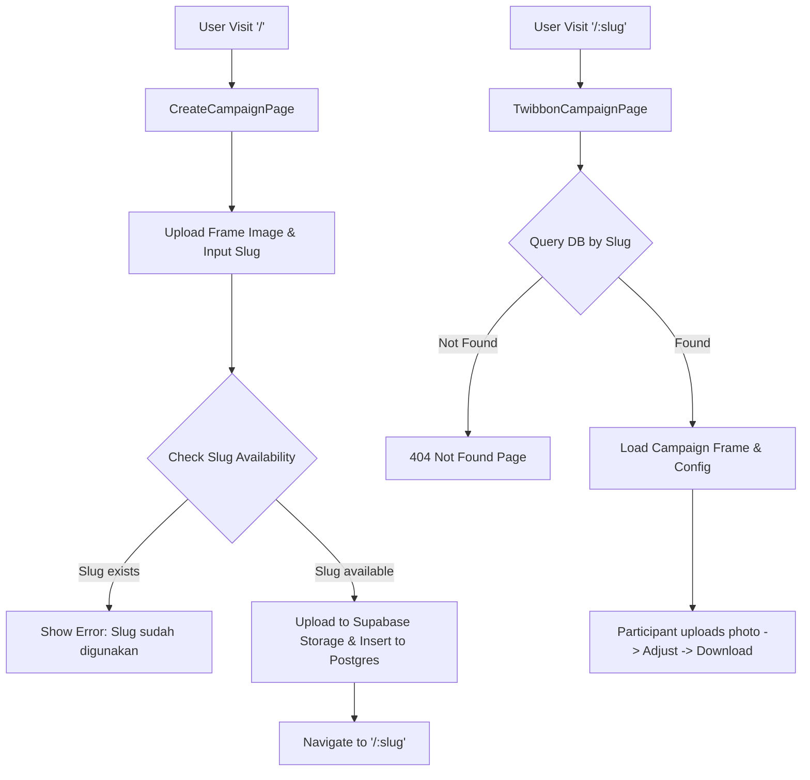

# Implementation Plan: 002 - Campaign Creation and Dynamic Slug Routing

## 1. Overview & Objectives

Rencana implementasi ini mencakup pengembangan alur interaksi pengguna tanpa autentikasi (login/register) untuk dua halaman utama:

1. **Rute `/` (Create Campaign):** Form pembuatan kampanye baru untuk mengunggah frame twibbon dan mendaftarkan URL unik (_slug_). Jika slug sudah terpakai, sistem menolak dan memberikan umpan balik langsung. Jika berhasil, sistem melakukan _redirect_ otomatis ke halaman kampanye.
2. **Rute `/:slug` (Campaign Participant Page):** Halaman publik dinamis berdasarkan slug yang menampilkan judul kampanye, memuat frame twibbon dari database/storage, dan menyediakan alur unggah foto partisipan, penyesuaian kanvas, serta ekspor gambar dan caption.

## 2. Design System Reference

Seluruh komponen UI harus mematuhi token dan prinsip desain pada:

- **Design Reference File:** `DevReferences/Skills/DESIGN.md`

---

## 3. Arsitektur Routing & Data Flow



---

## 4. Rincian Implementasi Langkah Demi Langkah

### Langkah 1: Pemasangan Library Routing & Client Supabase

Tambahkan paket yang dibutuhkan pada `package.json`:

- `react-router-dom` (untuk client-side routing `/` dan `/:slug`)
- `@supabase/supabase-js` (untuk komunikasi dengan PostgreSQL & Storage)

```bash
pnpm add react-router-dom @supabase/supabase-js
```

### Langkah 2: Setup Environment Variables & Supabase Client

Buat file `src/lib/supabase.ts` untuk inisialisasi client:

```typescript
import { createClient } from "@supabase/supabase-js";

const supabaseUrl = import.meta.env.VITE_SUPABASE_URL;
const supabaseAnonKey = import.meta.env.VITE_SUPABASE_ANON_KEY;

if (!supabaseUrl || !supabaseAnonKey) {
  console.warn("Supabase credentials missing in environment variables.");
}

export const supabase = createClient(supabaseUrl, supabaseAnonKey);
```

### Langkah 3: Konfigurasi Router di `src/App.tsx`

Ganti struktur monolitik di `App.tsx` dengan sistem routing deklaratif:

```tsx
import { BrowserRouter, Routes, Route } from "react-router-dom";
import CreateCampaignPage from "./pages/CreateCampaignPage";
import CampaignViewPage from "./pages/CampaignViewPage";
import NotFoundPage from "./pages/NotFoundPage";

export default function App() {
  return (
    <BrowserRouter>
      <Routes>
        <Route path="/" element={<CreateCampaignPage />} />
        <Route path="/:slug" element={<CampaignViewPage />} />
        <Route path="*" element={<NotFoundPage />} />
      </Routes>
    </BrowserRouter>
  );
}
```

---

### Langkah 4: Implementasi Halaman Buat Kampanye (`CreateCampaignPage.tsx`)

#### Fitur & Perilaku:

1. **Input Slug Interaktif:**
   - Input khusus dengan format huruf kecil, angka, dan tanda hubung (`-`).
   - Fungsi normalisasi otomatis: mengubah spasi atau karakter ilegal menjadi tanda hubung saat pengguna mengetik.
   - Pengecekan ketersediaan slug (_debounced availability check_ atau _on-blur_ query ke Supabase):
     ```typescript
     async function checkSlugAvailability(slug: string): Promise<boolean> {
       const { data, error } = await supabase
         .from("campaigns")
         .select("id")
         .eq("slug", slug.trim().toLowerCase())
         .maybeSingle();
       return !data; // true jika belum ada
     }
     ```
2. **Form Konfigurasi:**
   - Input Judul Acara (_Campaign Title_).
   - Input Deskripsi Singkat (_Description_ - opsional).
   - Dropzone/Upload file frame twibbon (dengan drag-and-drop dan preview instan).
   - Pengaturan template caption kustom dan placeholder variabel (default: `[name]`).
3. **Validasi & Submission:**
   - Memvalidasi slug tidak boleh bentrok dengan reserved route (misal: `admin`, `api`, `create`, `assets`).
   - Menjalankan upload file frame (mengikuti validator pada Plan 003).
   - Menyimpan metadata ke tabel `campaigns`.
   - Mengalihkan pengguna ke `/${slug}` secara instan setelah data tersimpan.

#### Desain Visual UI (Berdasarkan `DevReferences/Skills/DESIGN.md`):

- Card container dengan latar `#07080a` (Ink), border `#2f3031` (Slate).
- Status feedback ketersediaan slug:
  - Hijau (`#59d499`): _"Slug tersedia"_.
  - Merah (`#ff6363`): _"Slug sudah digunakan, pilih nama lain"_.
- Tombol aksi utama dengan fill `#e6e6e6` (Mist) dan teks hitam, atau `#ff6363` untuk penekanan branding.

---

### Langkah 5: Implementasi Halaman Kampanye Dinamis (`CampaignViewPage.tsx`)

#### Fitur & Perilaku:

1. **Pengambilan Data (Data Fetching):**
   - Mengambil parameter `:slug` menggunakan hook `useParams()`.
   - Mengambil data kampanye dari Supabase:
     ```typescript
     const { data: campaign, error } = await supabase
       .from("campaigns")
       .select("*")
       .eq("slug", slug)
       .single();
     ```
2. **State Handling:**
   - **Loading State:** Skeleton loader bertema gelap (`#111214` Obsidian shimmer).
   - **Error / Not Found State:** Menampilkan pesan _"Campaign tidak ditemukan"_ dengan tombol kembali ke halaman pembuatan twibbon `/`.
   - **Success State:** Memasok data dinamis (`frame_url`, `frame_width`, `frame_height`, `caption_template`, `caption_props`) ke dalam komponen twibbon yang sudah ada.
3. **Integrasi Alur Partisipan (3 Langkah):**
   - **Step 1:** Upload foto profil peserta.
   - **Step 2:** Sesuaikan letak foto di canvas (drag, scale, rotate) di bawah frame kustom milik kampanye tersebut.
   - **Step 3:** Isi variabel caption (nama, dll.) dan unduh hasil PNG.

---

### Langkah 6: Implementasi Halaman 404 (`NotFoundPage.tsx`)

- Tampilan minimalis berpusat di tengah layar (_centered dark layout_).
- Informasi jelas bahwa slug yang dituju tidak ada atau telah dihapus.
- Tombol aksi: _"Buat Twibbon Baru"_ yang mengarahkan ke `/`.

---

## 5. Rencana Pengujian (Test Plan)

1. **Pengujian Pembuatan Slug Baru:**
   - Akses `/`, unggah frame valid, masukkan slug `reuni-akbar-2026`. Submit form, pastikan diarahkan ke `/reuni-akbar-2026`.
2. **Pengujian Penolakan Slug Duplikat:**
   - Akses `/`, masukkan kembali slug `reuni-akbar-2026`. Sistem harus memvalidasi dan menampilkan pesan error merah `#ff6363`, tombol submit dinonaktifkan.
3. **Pengujian Halaman Dinamis:**
   - Akses `/reuni-akbar-2026`, pastikan frame yang muncul adalah frame yang baru saja diunggah, judul dan template caption sesuai dengan input saat pembuatan.
4. **Pengujian Halaman Tak Ditemukan:**
   - Akses `/slug-yang-pasti-tidak-ada-999`, pastikan menampilkan halaman 404 dengan tautan kembali ke `/`.
