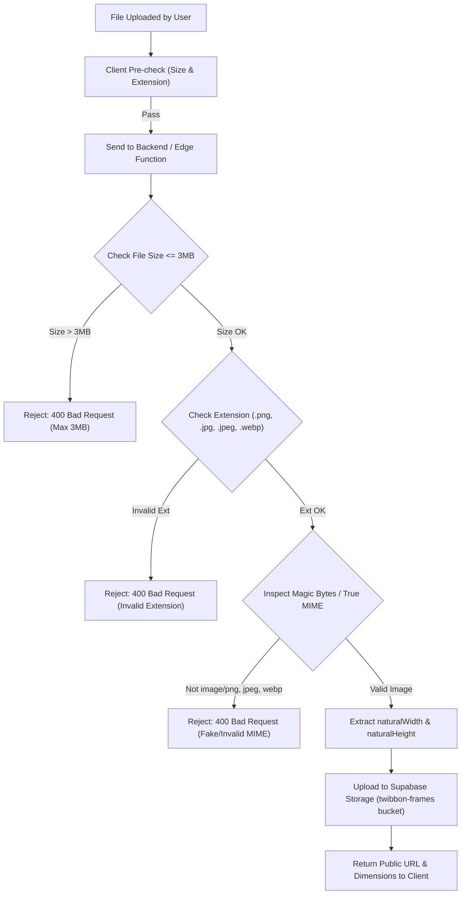

# Implementation Plan: 003 - Flexible Aspect Ratio and File Validation

## 1. Overview & Objectives

Dokumen rencana implementasi ini berfokus pada dua kapabilitas inti:

1. **Dukungan Aspek Rasio Kanvas Fleksibel:** Menghapus batasan kanvas kaku $1:1$ ($500 \times 500$ px). Kanvas twibbon harus menyesuaikan secara proporsional sesuai rasio asli gambar frame yang diunggah (misal: 4:5 portrait Instagram, 16:9 banner landscape, 9:16 reels/story, dsb.) tanpa memaksa pemotongan (_crop_).
2. **Backend Validator & Supabase Storage Integration:** Membangun validasi sisi server (backend) untuk memeriksa integritas berkas (MIME type sejati, ekstensi file yang diizinkan, dan batas ukuran maksimal 3MB) sebelum berkas disimpan ke dalam bucket publik Supabase Storage.
3. **Konfigurasi Environment Variables:** Mendefinisikan seluruh variabel lingkungan (`.env`) yang dibutuhkan.

## 2. Design System Reference

Seluruh implementasi antarmuka untuk dropzone upload, pesan validasi, indikator loading, dan preview kanvas merujuk pada:

- **Design Reference File:** `DevReferences/Skills/DESIGN.md` (Raycast Dark Style)

---

## 3. Konfigurasi Environment Variables (`.env`)

Buat file konfigurasi `.env` (dan dokumentasi `.env.example`) di root project dengan variabel berikut:

```env
# ==========================================
# SUPABASE CONFIGURATION
# ==========================================
# URL project Supabase Anda
VITE_SUPABASE_URL=https://your-project-id.supabase.co

# Public anon key untuk akses client-side (SELECT dan INSERT jika diizinkan RLS)
VITE_SUPABASE_ANON_KEY=eyJhbGciOiJIUzI1NiIsInR5cCI6IkpXVCJ9...

# Nama bucket penyimpanan publik di Supabase Storage
VITE_SUPABASE_STORAGE_BUCKET=twibbon-frames

# ==========================================
# SERVER / BACKEND CONFIGURATION (Edge Function / Node API)
# ==========================================
# Service role key (HANYA digunakan di backend / edge function, JANGAN ekspos ke client!)
SUPABASE_SERVICE_ROLE_KEY=eyJhbGciOiJIUzI1NiIsInR5cCI6IkpXVCJ9...

# Batas maksimal ukuran upload (dalam bytes: 3MB = 3145728 bytes)
MAX_FILE_SIZE_BYTES=3145728
```

---

## 4. Arsitektur & Logika Validasi File Backend



### 4.1 Implementasi Backend Validator (Supabase Edge Function: `validate-and-upload`)

Buat fungsi serverless di `supabase/functions/upload-frame/index.ts` untuk memverifikasi file secara aman:

```typescript
import { serve } from "https://deno.land/std@0.168.0/http/server.ts";
import { createClient } from "https://esm.sh/@supabase/supabase-js@2";

const ALLOWED_MIME_TYPES = ["image/png", "image/jpeg", "image/webp"];
const ALLOWED_EXTENSIONS = ["png", "jpg", "jpeg", "webp"];
const MAX_FILE_SIZE = 3 * 1024 * 1024; // 3MB

// Magic bytes signatures
function verifyMagicBytes(bytes: Uint8Array): string | null {
  // PNG: 89 50 4E 47 0D 0A 1A 0A
  if (
    bytes[0] === 0x89 &&
    bytes[1] === 0x50 &&
    bytes[2] === 0x4e &&
    bytes[3] === 0x47
  ) {
    return "image/png";
  }
  // JPEG: FF D8 FF
  if (bytes[0] === 0xff && bytes[1] === 0xd8 && bytes[2] === 0xff) {
    return "image/jpeg";
  }
  // WEBP: 'RIFF'....'WEBP' (52 49 46 46 ... 57 45 42 50)
  if (
    bytes[0] === 0x52 &&
    bytes[1] === 0x49 &&
    bytes[2] === 0x46 &&
    bytes[3] === 0x46 &&
    bytes[8] === 0x57 &&
    bytes[9] === 0x45 &&
    bytes[10] === 0x42 &&
    bytes[11] === 0x50
  ) {
    return "image/webp";
  }
  return null;
}

serve(async (req) => {
  // Handle CORS Preflight
  if (req.method === "OPTIONS") {
    return new Response("ok", {
      headers: {
        "Access-Control-Allow-Origin": "*",
        "Access-Control-Allow-Methods": "POST, OPTIONS",
        "Access-Control-Allow-Headers": "Content-Type, Authorization",
      },
    });
  }

  try {
    const formData = await req.formData();
    const file = formData.get("frame") as File;
    const slug = (formData.get("slug") as string)?.trim().toLowerCase();

    if (!file || !slug) {
      return new Response(
        JSON.stringify({ error: "File frame dan slug wajib disertakan." }),
        {
          status: 400,
          headers: { "Content-Type": "application/json" },
        }
      );
    }

    // 1. Validasi Ukuran File (Maksimal 3MB)
    if (file.size > MAX_FILE_SIZE) {
      return new Response(
        JSON.stringify({
          error: `Ukuran file melebihi batas maksimal 3MB (Ukuran file: ${(
            file.size /
            (1024 * 1024)
          ).toFixed(2)} MB).`,
        }),
        { status: 400, headers: { "Content-Type": "application/json" } }
      );
    }

    // 2. Validasi Ekstensi Berkas
    const fileExt = file.name.split(".").pop()?.toLowerCase() || "";
    if (!ALLOWED_EXTENSIONS.includes(fileExt)) {
      return new Response(
        JSON.stringify({
          error:
            "Ekstensi file tidak didukung. Hanya diperbolehkan: .png, .jpg, .jpeg, .webp.",
        }),
        { status: 400, headers: { "Content-Type": "application/json" } }
      );
    }

    // 3. Validasi Magic Bytes (Deteksi Asli MIME Type)
    const arrayBuffer = await file.arrayBuffer();
    const headerBytes = new Uint8Array(arrayBuffer.slice(0, 16));
    const detectedMime = verifyMagicBytes(headerBytes);

    if (!detectedMime || !ALLOWED_MIME_TYPES.includes(detectedMime)) {
      return new Response(
        JSON.stringify({
          error:
            "Format berkas tidak valid atau rusak. Harus berupa gambar PNG, JPG/JPEG, atau WEBP asli.",
        }),
        { status: 400, headers: { "Content-Type": "application/json" } }
      );
    }

    // 4. Inisialisasi Supabase Admin Client
    const supabaseAdmin = createClient(
      Deno.env.get("SUPABASE_URL") ?? "",
      Deno.env.get("SUPABASE_SERVICE_ROLE_KEY") ?? ""
    );

    // 5. Upload ke Supabase Storage (Bucket: twibbon-frames)
    const fileName = `${slug}-${Date.now()}.${fileExt}`;
    const bucketName =
      Deno.env.get("VITE_SUPABASE_STORAGE_BUCKET") || "twibbon-frames";

    const { data: uploadData, error: uploadError } = await supabaseAdmin.storage
      .from(bucketName)
      .upload(fileName, arrayBuffer, {
        contentType: detectedMime,
        upsert: false,
      });

    if (uploadError) {
      return new Response(JSON.stringify({ error: uploadError.message }), {
        status: 500,
        headers: { "Content-Type": "application/json" },
      });
    }

    // Dapatkan Public URL
    const { data: urlData } = supabaseAdmin.storage
      .from(bucketName)
      .getPublicUrl(fileName);

    return new Response(
      JSON.stringify({
        success: true,
        frameUrl: urlData.publicUrl,
        fileName: fileName,
      }),
      { status: 200, headers: { "Content-Type": "application/json" } }
    );
  } catch (err: any) {
    return new Response(
      JSON.stringify({ error: err.message || "Internal server error" }),
      {
        status: 500,
        headers: { "Content-Type": "application/json" },
      }
    );
  }
});
```

---

## 5. Rekayasa Kanvas Aspek Rasio Fleksibel (`TwibbonCanvas.tsx`)

### 5.1 Permasalahan Pada Implementasi Lama:

- Kode saat ini mematok kanvas fixed $500 \times 500$ px:
  ```typescript
  const size = 500;
  ctx?.clearRect(0, 0, size, size);
  ctx?.drawImage(frameRef.current, 0, 0, size, size);
  ```
- Ini menyebabkan gambar non-persegi (seperti 1080x1350 atau 1920x1080) terdistorsi atau terpotong paksa menjadi persegi $1:1$.

### 5.2 Desain Solusi Kanvas Dinamis:

1. **Deteksi Dimensi Asli:** Saat gambar frame dimuat (`frameRef.onload`), baca `naturalWidth` dan `naturalHeight`.
2. **Normalisasi Resolusi Kanvas Ekspor:**
   - Gunakan resolusi dasar sesuai ukuran asli frame (misal $1080 \times 1350$ px) agar kualitas unduhan tetap tajam (_high-resolution_).
   - Tentukan `width = frame.naturalWidth` dan `height = frame.naturalHeight`.
3. **Titik Pusat Transformasi Foto:**
   - Pusatkan translasi pada koordinat tengah kanvas:
     $$\text{center}_X = \frac{\text{width}}{2} + \text{transform.x}$$
     $$\text{center}_Y = \frac{\text{height}}{2} + \text{transform.y}$$
4. **Normalisasi Pointer Drag untuk Rasio Non-1:1:**

   - Rasio skala drag pada sumbu X dan Y dihitung terpisah sesuai ukuran display visual elemen kanvas:

     ```typescript
     const ratioX = canvas.width / canvas.clientWidth;
     const ratioY = canvas.height / canvas.clientHeight;

     setTransform((prev) => ({
       ...prev,
       x: prev.x + dx * ratioX,
       y: prev.y + dy * ratioY,
     }));
     ```

5. **Container Preview CSS yang Adaptif:**
   - Terapkan `max-h-[70vh]`, `max-w-full`, dan `w-auto h-auto object-contain` sehingga frame dengan aspek rasio apapun (potret tinggi atau lanskap lebar) tetap proporsional dan tidak melebihi area pandang layar pengguna.

### 5.3 Contoh Implementasi Refaktor `TwibbonCanvas.tsx`:

```tsx
import { useEffect, useRef, useState } from "react";

type TransformType = {
  x: number;
  y: number;
  scale: number;
  rotate: number;
};

type CanvasProps = {
  isEditMode: boolean;
  transform: TransformType;
  setTransform: React.Dispatch<React.SetStateAction<TransformType>>;
  userPhoto: HTMLImageElement | null;
  frameSrc: string;
  canvasRef: React.RefObject<HTMLCanvasElement | null>;
  onDimensionsLoaded?: (width: number, height: number) => void;
};

export default function TwibbonCanvas({
  userPhoto,
  transform,
  frameSrc,
  isEditMode,
  setTransform,
  canvasRef,
  onDimensionsLoaded,
}: CanvasProps) {
  const [dimensions, setDimensions] = useState({ width: 1080, height: 1080 });
  const frameRef = useRef(new Image());
  const isDragging = useRef(false);
  const lastPos = useRef({ x: 0, y: 0 });

  function draw() {
    const canvas = canvasRef?.current;
    if (!canvas) return;

    const ctx = canvas.getContext("2d");
    if (!ctx) return;

    const { width, height } = dimensions;
    ctx.clearRect(0, 0, width, height);

    // 1. Draw User Photo (Layer Bawah)
    if (userPhoto) {
      ctx.save();
      ctx.translate(width / 2 + transform.x, height / 2 + transform.y);
      ctx.rotate((transform.rotate * Math.PI) / 180);
      ctx.scale(transform.scale / 100, transform.scale / 100);
      ctx.drawImage(userPhoto, -userPhoto.width / 2, -userPhoto.height / 2);
      ctx.restore();
    }

    // 2. Draw Frame Overlay (Layer Atas)
    if (frameRef.current.complete && frameRef.current.naturalWidth > 0) {
      ctx.drawImage(frameRef.current, 0, 0, width, height);
    }
  }

  useEffect(() => {
    frameRef.current.crossOrigin = "anonymous";
    frameRef.current.src = frameSrc;
    frameRef.current.onload = () => {
      const w = frameRef.current.naturalWidth || 1080;
      const h = frameRef.current.naturalHeight || 1080;
      setDimensions({ width: w, height: h });
      onDimensionsLoaded?.(w, h);
      draw();
    };
  }, [frameSrc]);

  useEffect(draw, [userPhoto, transform, dimensions]);

  function handleDragDown(e: React.PointerEvent<HTMLCanvasElement>) {
    if (!isEditMode) return;
    isDragging.current = true;
    lastPos.current = { x: e.clientX, y: e.clientY };
    e.currentTarget.setPointerCapture(e.pointerId);
  }

  function handleDragMove(e: React.PointerEvent<HTMLCanvasElement>) {
    if (!isEditMode || !isDragging.current || !canvasRef.current) return;

    const dx = e.clientX - lastPos.current.x;
    const dy = e.clientY - lastPos.current.y;
    lastPos.current = { x: e.clientX, y: e.clientY };

    const canvas = canvasRef.current;
    const ratioX = canvas.width / canvas.clientWidth;
    const ratioY = canvas.height / canvas.clientHeight;

    setTransform((prev) => ({
      ...prev,
      x: prev.x + dx * ratioX,
      y: prev.y + dy * ratioY,
    }));
  }

  function handleDragUp() {
    if (!isEditMode) return;
    isDragging.current = false;
  }

  return (
    <div className="flex justify-center items-center p-2 bg-[#07080a] border border-[#2f3031] rounded-2xl overflow-hidden shadow-2xl">
      <canvas
        ref={canvasRef}
        width={dimensions.width}
        height={dimensions.height}
        className={`max-h-[65vh] max-w-full w-auto h-auto object-contain select-none touch-none ${
          isEditMode ? "cursor-move" : ""
        }`}
        onPointerDown={handleDragDown}
        onPointerMove={handleDragMove}
        onPointerUp={handleDragUp}
      />
    </div>
  );
}
```

---

## 6. Rencana Pengujian (Test Plan)

1. **Uji Aspek Rasio Beragam:**
   - Unggah frame ukuran $1080 \times 1080$ (1:1 persegi) $\rightarrow$ Kanvas harus berbentuk bujur sangkar.
   - Unggah frame ukuran $1080 \times 1350$ (4:5 potret Instagram) $\rightarrow$ Kanvas vertikal tanpa distorsi.
   - Unggah frame ukuran $1920 \times 1080$ (16:9 lanskap) $\rightarrow$ Kanvas memanjang horizontal tanpa stretching.
2. **Uji Validasi Ukuran (> 3MB):**
   - Coba unggah file gambar berukuran 3.5MB. Backend harus menolak dengan respons HTTP 400 dan pesan error yang ramah pengguna.
3. **Uji Validasi Tipe Ekstensi & MIME:**
   - Coba unggah file `.pdf`, `.svg`, `.exe`, atau `.gif`. Sistem harus menolak dengan error ekstensi tidak didukung.
   - Coba ubah nama file dokumen teks/PDF menjadi `.png` (fake extension). Pengecekan magic bytes harus mendeteksi ketidakcocokan dan menolak file dengan HTTP 400.
4. **Uji Supabase Storage:**
   - Periksa dashboard Supabase Storage bucket `twibbon-frames`. Pastikan file frame yang berhasil divalidasi tersimpan dengan URL publik yang dapat diakses langsung.
